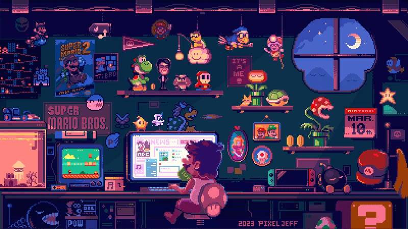

<!--
  =====================================================================
  THE DIGITAL WORKSHOP — Engineering Systems. Building Worlds.
  =====================================================================
  CARA EDIT CEPAT:
  1. Cari & ganti semua  YOUR_USERNAME  dengan username GitHub kamu.
  2. Cari  [PLACEHOLDER]  dan isi dengan data aslimu.
  3. Letakkan banner di  assets/profile-banner.gif
  Palet: bg 0D1117 | surface 161B22 | card 1C2333 | biru 58A6FF
         ungu 8B7CF6 | teal 56D4C5 | teks E6EDF3 / 8B949E | border 30363D
-->

<!-- ============================ A. HERO ============================ -->

<h3>&gt; boot sequence complete. workshop is open.</h3>

  <b>Information Technology Student</b> &nbsp;·&nbsp;
  <b>Software Developer</b> &nbsp;·&nbsp;
  <b>Aspiring Game Developer</b>

<i>Suka tahu apa yang terjadi di balik layar, lalu membangun dunia di atasnya.</i>

  
  
  

 

<!-- ============================ B. ABOUT ============================ -->

## About Me

<table>
  <tr>
    <td width="58%" valign="top">

**Mahasiswa Teknologi Informasi yang penasaran dengan cara kerja sesuatu.**

- Kuliah di jurusan Teknologi Informasi, belajar paling cepat lewat proyek nyata, bukan cuma teori.
- Tertarik pada software development dan _system internals_: apa yang sebenarnya terjadi di bawah kode yang saya tulis.
- Menjelajahi networking dan cybersecurity, termasuk soal-soal CTF.
- Suka hardware yang bisa disentuh: embedded systems dan IoT.
- Pernah jadi gamer, sekarang lebih tertarik membuat game dan pixel art-nya.

  </td>
    <td width="42%" valign="top">

**Currently Exploring**

- Game development dengan Godot dan Unity
- Roblox Studio dan Lua scripting _(baru belajar)_
- Pixel art dan pembuatan aset game
- System programming dan networking

  </td>
  </tr>
</table>

 

<!-- ========================= C. TECH STACK ========================= -->

## Tech Stack & Tools

<!-- Badge gelap = dipakai. Badge berlabel "learning" = masih dipelajari. -->

**Programming Languages**

**Web Development**

**Networking & Infrastructure**

**Embedded Systems & IoT**

**Game Development & Creative Tools**

 

<!-- ===================== D. GITHUB STATS DASHBOARD ===================== -->

## GitHub Dashboard

<!--
  Semua angka diambil otomatis oleh layanan di bawah, tidak ada yang ditulis manual.
  Warna widget (hex tanpa #): bg 1C2333 | judul 58A6FF | ikon 56D4C5 | teks E6EDF3 | border 30363D
-->

<!-- Row 1 -->
<table>
  <tr>
    <td width="50%" align="center">
      
    </td>
    <td width="50%" align="center">
      
    </td>
  </tr>

  <!-- Row 2 -->
  <tr>
    <td width="50%" align="center">
      
    </td>
    <td width="50%" align="center">
      
    </td>
  </tr>
</table>

<!-- Row 3: lebar penuh -->

  

<!-- OPSIONAL: aktifkan jika layout masih terasa lega

  

-->

Widget tidak muncul? Lihat statistik langsung di <a href="https://github.com/YOUR_USERNAME">github.com/YOUR_USERNAME</a>. Layanan gratis ini kadang kena rate limit.

 

<!-- ======================= E. FEATURED PROJECTS ======================= -->

## Featured Projects

<!-- Salin satu <td> untuk menambah proyek. Isi semua [PLACEHOLDER]. -->
<table>
  <tr>
    <td width="33%" valign="top">

**[PLACEHOLDER: Nama Proyek 1]**

[PLACEHOLDER: deskripsi satu atau dua kalimat tentang apa yang dibuat dan masalah apa yang diselesaikan]

`[Teknologi]` `[Teknologi]` `[Teknologi]`

[Repository](https://github.com/YOUR_USERNAME/[PLACEHOLDER-repo]) · [Demo]([PLACEHOLDER-demo-url])

  </td>
    <td width="33%" valign="top">

**[PLACEHOLDER: Nama Proyek 2]**

[PLACEHOLDER: deskripsi satu atau dua kalimat]

`[Teknologi]` `[Teknologi]` `[Teknologi]`

[Repository](https://github.com/YOUR_USERNAME/[PLACEHOLDER-repo]) · [Demo]([PLACEHOLDER-demo-url])

  </td>
    <td width="33%" valign="top">

**[PLACEHOLDER: Nama Proyek 3]**

[PLACEHOLDER: deskripsi satu atau dua kalimat]

`[Teknologi]` `[Teknologi]` `[Teknologi]`

[Repository](https://github.com/YOUR_USERNAME/[PLACEHOLDER-repo]) · [Demo]([PLACEHOLDER-demo-url])

  </td>
  </tr>
</table>

 

<!-- ========================== F. FIND ME ON ========================== -->

## Find Me On

  
  
  
  

 

<!-- ============================ G. FOOTER ============================ -->

---

<code>Still learning, still building, still exploring.</code>

